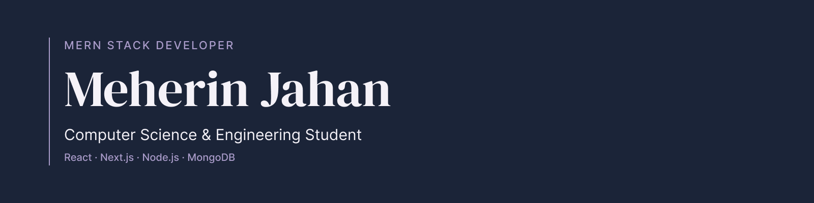

<h1 align="center">Hi, I'm Meherin Jahan</h1>

  <strong>MERN Stack Developer · Computer Science & Engineering Student</strong>

  <a href="https://portfoliomeherin.vercel.app/">Portfolio</a> ·
  <a href="https://www.linkedin.com/in/meherin-jahan">LinkedIn</a> ·
  <a href="https://github.com/meherin02?tab=repositories">Repositories</a>

## About me

I'm a Computer Science and Engineering student building web applications with React, Next.js, Node.js, and MongoDB. I enjoy working across interfaces, APIs, and databases to turn practical ideas into usable software.

My projects explore local volunteering, grocery price comparisons, and personal fitness. I have also collaborated on a climate data explorer focused on Bangladesh.

## Technologies I work with

**Frontend**

**Backend & databases**

**Development tools**

## Selected projects

### Community Events
A platform for discovering, organizing, and joining local volunteering events, with event management and registration features.

**Built with** Next.js, Express, MongoDB  
[Explore the live application](https://communityevents-mauve.vercel.app/)

### BazarDor
A Bangla grocery price tracker with category filters, price sorting, and comparisons across markets.

**Built with** Next.js, TypeScript, Supabase  
[Explore the live application](https://b14-assignment7-meherin.vercel.app/)

### TerraPulse AI
A team project exploring temperature and precipitation trends across Bangladesh using NASA POWER data, with charts, trend estimates, and confidence intervals.

**Team** Neurastra  
[Explore the live application](https://terrapulseaiteamneurastra.vercel.app/)

### FitLog
A responsive workout planner with a 12-exercise library, daily workout planning, and set tracking.

**Built with** Next.js, Tailwind CSS  
[Explore the live application](https://b14a6meherin.vercel.app/)

## Connect with me

Interested in discussing a project or exchanging ideas about web development? Connect with me on LinkedIn.

[LinkedIn](https://www.linkedin.com/in/meherin-jahan) · [Portfolio](https://portfoliomeherin.vercel.app/)
